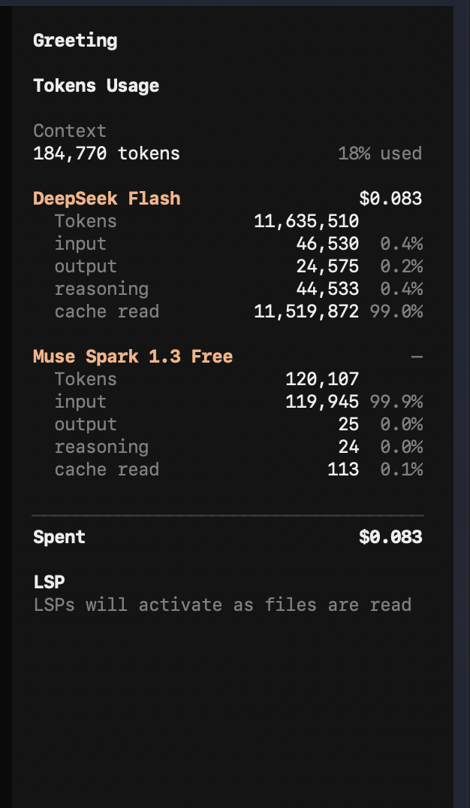

# opencode-usage-panel

A sidebar panel for the [opencode](https://opencode.ai) TUI that breaks a
session down by model: how many tokens each one consumed and what it cost.

<p align="center">
  
</p>

The `Context` block mirrors opencode's built-in panel — the token count and
share of the context window for the latest assistant turn — but leaves out its
cost, which does not account for peak pricing.

Each model gets a header row with its estimated cost, then the `input`
(cache miss), `output`, `reasoning`, and `cache read` (cache hit) counters
summed over the session. The percentage on each row is that counter's share of
the model's own total tokens.

## Requirements

- opencode `>= 2.3.0`

The plugin is a TUI plugin: it imports from `@opencode/plugin/tui` and renders
into the `sidebar.content` slot alongside other sidebar panels.

## Install

### From npm

Install and register the plugin globally with the OpenCode CLI:

```sh
opencode plugin add opencode-usage-panel
```

### From a git checkout

```sh
opencode plugin add https://github.com/shiv-source/opencode-usage-panel
```

### From a local checkout

Clone the repository and point `plugins` in `~/.config/opencode/cli.json` at the directory:

```jsonc
{
  "$schema": "https://opencode.ai/v2/cli.json",
  "plugins": ["/abs/path/opencode-usage-panel"]
}
```

### Disable the built-in panel

The `Context` block reports the same numbers as opencode's built-in context
panel, so turn that one off to avoid stacking:

```jsonc
{
  "plugins": ["*", "-opencode.sidebar.context"]
}
```

## Pricing & Options

Cost is computed per message from a rate table, so peak/off-peak pricing is
honoured using each message's own timestamp. Models without a configured rate
table fall back to the `cost` opencode records, which is priced automatically
from [models.dev](https://models.dev) (free tiers show `—`).

Options (`pricing`, `peakHours`, `timezone`) are configured via the `plugins`
object form in `~/.config/opencode/cli.json`:

```jsonc
{
  "$schema": "https://opencode.ai/v2/cli.json",
  "plugins": [
    {
      "package": "opencode-usage-panel",
      "options": {
        "pricing": {
          "deepseek-flash": {
            "input": 0.15,
            "output": 0.6,
            "cacheRead": 0.003,
            "peak": {
              "input": 0.3,
              "output": 1.2,
              "cacheRead": 0.006
            }
          }
        }
      }
    }
  ]
}
```

(Replace `"package"` with the absolute path of a local checkout, or a git URL, when not installing from npm.)

### Subagent usage

Usage from subagent sessions spawned by the current session is included by
default, so every model that worked on the session shows up in the panel.
Set `"includeSubagents": false` to scope the panel to the current session
only:

```jsonc
{
  "plugins": [
    {
      "package": "opencode-usage-panel",
      "options": { "includeSubagents": false }
    }
  ]
}
```

The `Context` block always reflects the current session.

### Rate tables

Prices are US dollars per million tokens. `input` is cache-miss input,
`cacheRead` is cache-hit input, and `output` also covers `reasoning` unless a
separate `reasoning` rate is given.

Keys can be a bare `modelID` or `providerID/modelID`. Top-level rates apply
outside peak windows; the optional `peak` block replaces them inside peak
windows. A model without `peak` has flat pricing.

### Peak windows

`peakHours` is always specified in **UTC**, since that is how providers publish
their schedules. Windows may wrap past midnight, and `days` restricts them to
UTC weekdays (`mon`..`sun`, JS-style `0`..`6` also accepted; omit for every
day). DeepSeek's schedule — weekdays `01:00-04:00` and `06:00-10:00` UTC — is:

```jsonc
{
  "peakHours": [
    { "start": "01:00", "end": "04:00", "days": ["mon", "tue", "wed", "thu", "fri"] },
    { "start": "06:00", "end": "10:00", "days": ["mon", "tue", "wed", "thu", "fri"] }
  ]
}
```

Messages are matched against these windows in UTC, so the result is correct
whatever your machine's timezone is. For display, times are converted to your
local timezone by default (`IST` for `Asia/Kolkata`); set `"timezone": "utc"` to
render them in UTC instead.

The extra cost paid for peak messages is shown under `Spent`. While a peak
window is active the panel shows a `▲ peak` badge next to affected models and
the time the window ends; otherwise it lists the configured peak windows.

## License

MIT — see [LICENSE](LICENSE).
